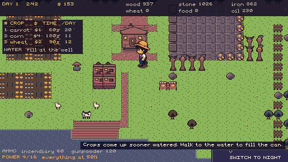

# HARVEST THE NIGHT - a devlog

*Thirty seconds, one seed: a day of farming, the light going over, a night holding, and the fence coming down.*

The idea was one sentence long: **a farm that is also a fortress**, with no
second map and no loading screen between the two. You work a field all day
and then something walks over that same field at night. Everything that
matters about this game comes out of refusing to let those be two places.

What that turned out to mean, over a hundred and ten tasks, is that almost
every hard problem was the *same* problem wearing different clothes. The
rules had to be one flat dictionary of plain data so that the same state
could be saved, hashed, replayed, diffed and screenshotted - and the moment
anything reached for a node or a clock or an unsorted dictionary, something
downstream broke quietly. Half the entries below are that lesson being
learned again somewhere new.

The other half is checks. Not tests written afterwards to feel safe: checks
written to fail, planted with the bug they were supposed to catch, and
rewritten when they passed anyway. Three of the entries below are a check
that had been passing for twenty-odd tasks without being able to fail. That
is the sort of thing this list exists to say out loud.

## What it was meant to be

> A cozy farming game where your farm is also your fortress.
>
> By day, plant, fish, mine and make things.
>
> At night, reality switches and the same farm becomes a fortress against the
>
> horde.
>
> Everything you make by day decides what you can build after dark.
>
> Build your farm. Build your defence. Find out whether it holds.
>

## What it turned out to be

232 tasks over 9 days,  to 2026-10-11. One at a time, each one finished and checked before the next was started.

| # | What was built | Finished |
|---|---|---|
| 0042 | The shooting tower | 2026-09-27 |
| 0000 | The backlog itself | 2026-09-27 |
| 0001 | Godot project scaffold | 2026-09-27 |
| 0002 | Fixed-timestep deterministic simulation | 2026-09-27 |
| 0003 | game_data.gd, the one file of levers | 2026-09-27 |
| 0004 | Harden the headless check harness | 2026-09-27 |
| 0005 | verify.py and the determinism guard | 2026-09-27 |
| 0006 | The phase machine: day, preparation, night, result | 2026-09-27 |
| 0007 | The resource ledger | 2026-09-27 |
| 0008 | The farm grid | 2026-09-27 |
| 0009 | Settings singleton | 2026-09-27 |
| 0010 | Save the profile and the run | 2026-09-27 |
| 0011 | input_check harness | 2026-09-27 |
| 0012 | Debug overlay | 2026-09-27 |
| 0013 | The world renders | 2026-09-27 |
| 0014 | Sprites generated from ASCII maps | 2026-09-27 |
| 0015 | The player walks and interacts | 2026-09-27 |
| 0016 | Trees and wood | 2026-09-27 |
| 0017 | Rocks and stone | 2026-09-27 |
| 0018 | Wheat: till, plant, grow, harvest | 2026-09-27 |
| 0019 | The workshop and its first recipe | 2026-09-27 |
| 0020 | The shop: sell and buy | 2026-09-27 |
| 0021 | The day HUD | 2026-09-27 |
| 0022 | Switching reality | 2026-09-27 |
| 0023 | Build mode | 2026-09-27 |
| 0024 | The shooting tower | 2026-09-27 |
| 0025 | Zombies walk to the house | 2026-09-27 |
| 0026 | The tower kills the zombie | 2026-09-27 |
| 0027 | Three waves, a result screen, and back to the farm | 2026-09-27 |
| 0028 | Corn and carrot |  |
| 0029 | Growth stages and watering | 2026-09-27 |
| 0030 | Fishing | 2026-09-27 |
| 0031 | Iron from the rock face | 2026-09-27 |
| 0032 | Oil | 2026-09-27 |
| 0033 | The generator and energy | 2026-09-27 |
| 0034 | Cooking: food and meat | 2026-09-27 |
| 0035 | Gunpowder and ammunition | 2026-09-27 |
| 0036 | The inventory | 2026-09-27 |
| 0037 | The workshop queue | 2026-09-27 |
| 0038 | Production runs while you are elsewhere | 2026-09-27 |
| 0039 | The day clock and dusk | 2026-09-27 |
| 0040 | The shop grows | 2026-09-27 |
| 0041 | The first day teaches itself | 2026-09-27 |
| 0042 | Data-driven defences | 2026-09-27 |
| 0043 | The flamethrower tower | 2026-09-27 |
| 0044 | The mortar | 2026-09-27 |
| 0045 | The auto-crossbow | 2026-09-27 |
| 0046 | Fences and walls | 2026-09-27 |
| 0047 | Barricades | 2026-09-27 |
| 0048 | Mines and traps |  |
| 0049 | Zombies path around walls |  |
| 0050 | The runner |  |
| 0051 | The tank |  |
| 0052 | The breaker |  |
| 0053 | Repair during the night |  |
| 0054 | The player's ability |  |
| 0055 | Double speed and skipping the night |  |
| 0056 | The night HUD |  |
| 0057 | Structures take damage and die |  |
| 0058 | The Giant |  |
| 0059 | Waves as data |  |
| 0060 | The ten nights, authored |  |
| 0061 | Night rewards |  |
| 0062 | Technology points |  |
| 0063 | The tech tree |  |
| 0064 | Tower I, II, automatic |  |
| 0065 | Losing a night costs you |  |
| 0066 | Night 10 and the end of the run |  |
| 0067 | The autoplayer |  |
| 0068 | A balance sweep over the ten nights |  |
| 0069 | Run statistics | 2026-09-27 |
| 0070 | Endless nights past ten | 2026-09-27 |
| 0071 | The two palettes | 2026-09-27 |
| 0072 | The farm tileset | 2026-09-28 |
| 0073 | The player sprite | 2026-09-28 |
| 0074 | Zombie sprites | 2026-09-28 |
| 0075 | Buildings and towers | 2026-09-28 |
| 0076 | Night lighting | 2026-09-28 |
| 0077 | Particles | 2026-09-28 |
| 0078 | The reality transition | 2026-09-28 |
| 0079 | Resource icons and the UI kit | 2026-09-28 |
| 0080 | A pixel font | 2026-09-28 |
| 0081 | The UI theme | 2026-09-28 |
| 0082 | Screenshots, and actually looking at them | 2026-09-28 |
| 0083 | Audio buses and a sound manager | 2026-09-28 |
| 0084 | The sounds of the day | 2026-09-28 |
| 0085 | The sounds of the night | 2026-09-28 |
| 0086 | Two pieces of music | 2026-09-28 |
| 0087 | Ambience | 2026-09-28 |
| 0088 | Juice: shake, hit stop, damage numbers | 2026-09-28 |
| 0089 | Tooltips | 2026-09-28 |
| 0090 | The log panel | 2026-09-28 |
| 0091 | The title screen | 2026-09-28 |
| 0092 | The main menu and the router | 2026-09-28 |
| 0093 | Options: video | 2026-09-28 |
| 0094 | Options: audio | 2026-09-28 |
| 0095 | Options: controls | 2026-09-28 |
| 0096 | The pause menu | 2026-09-28 |
| 0097 | English and Portuguese | 2026-09-28 |
| 0098 | Accessibility | 2026-09-28 |
| 0099 | An icon and a boot ident | 2026-09-28 |
| 0100 | Exports: Windows and Web | 2026-09-28 |
| 0101 | Onboarding in seven lines | 2026-09-28 |
| 0102 | A performance budget | 2026-09-28 |
| 0103 | Crash and error reporting | 2026-09-28 |
| 0104 | Saves survive an update | 2026-09-28 |
| 0105 | A playtest build | 2026-09-28 |
| 0106 | The release checklist | 2026-09-28 |
| 0107 | Store assets | 2026-09-28 |
| 0108 | The devlog and a trailer clip | 2026-09-29 |
| 0109 | The character reacts | 2026-09-29 |
| 0110 | Refusals in two languages | 2026-09-29 |
| 0112 | Room in the test suites | 2026-10-07 |
| 0113 | Repairs mend to the real maximum | 2026-10-07 |
| 0114 | Untouched means the house the night started with | 2026-10-07 |
| 0115 | Spawn ground that cannot be built shut | 2026-10-07 |
| 0116 | The mortar and the flamethrower, empty and upgraded | 2026-10-07 |
| 0117 | Three stale documents | 2026-10-07 |
| 0118 | One road into the waves | 2026-10-07 |
| 0119 | Tests and tools build in the build step | 2026-10-08 |
| 0120 | One road for art that has not arrived | 2026-10-08 |
| 0121 | A controller for every action | 2026-10-08 |
| 0126 | The clock: 06:00 to 02:00 | 2026-10-08 |
| 0127 | Going to bed starts the night | 2026-10-08 |
| 0128 | Passing out at 02:00 | 2026-10-08 |
| 0129 | He stays in bed all night | 2026-10-08 |
| 0130 | The night camera | 2026-10-08 |
| 0131 | The guardian's cursor | 2026-10-08 |
| 0132 | Defences go down only at night | 2026-10-08 |
| 0133 | The hotbar of defences | 2026-10-08 |
| 0134 | Repairing by cursor | 2026-10-08 |
| 0135 | The flare goes where you aim it | 2026-10-08 |
| 0136 | The build step waits for START | 2026-10-08 |
| 0137 | The night ends at 06:00 | 2026-10-08 |
| 0138 | Waking up: the morning report | 2026-10-08 |
| 0122 | Art: the farmer's run - done 2026-10-08 (cancelled by the owner) |  |
| 0139 | The night HUD for the guardian | 2026-10-08 |
| 0140 | The day HUD: the hour and bedtime | 2026-10-08 |
| 0141 | Teaching the new night | 2026-10-08 |
| 0142 | The autoplayer sleeps too | 2026-10-08 |
| 0148 | Checkpoint: is the night better with him asleep? | 2026-10-08 |
| 0149 | The calendar: four seasons of fourteen days | 2026-10-08 |
| 0150 | Nights looked up by the calendar | 2026-10-08 |
| 0151 | The night is the calendar day | 2026-10-08 |
| 0152 | Full Moon nights | 2026-10-08 |
| 0153 | Boss nights repeat until the boss falls | 2026-10-08 |
| 0154 | The calm night after a boss | 2026-10-08 |
| 0155 | Losing a night when the calendar moves on | 2026-10-08 |
| 0156 | The 1.0 farm map | 2026-10-08 |
| 0157 | A new side every season | 2026-10-08 |
| 0158 | The forecast | 2026-10-08 |
| 0159 | Seasons on screen | 2026-10-08 |
| 0160 | The end of the year | 2026-10-09 |
| 0165 | Crops grow by days | 2026-10-09 |
| 0166 | A day of eight to ten minutes | 2026-10-09 |
| 0167 | Any grass can be tilled | 2026-10-09 |
| 0168 | Nine new crops | 2026-10-09 |
| 0169 | An inventory for many things | 2026-10-09 |
| 0170 | Crops keep to their seasons | 2026-10-09 |
| 0171 | Winter: nothing grows outside | 2026-10-09 |
| 0172 | Crops that grow back | 2026-10-09 |
| 0173 | Five tools, three tiers | 2026-10-09 |
| 0174 | The can and the hoe by tier | 2026-10-09 |
| 0175 | The axe and the pickaxe by tier | 2026-10-09 |
| 0176 | Copper, coal and gold | 2026-10-09 |
| 0177 | Hardwood | 2026-10-09 |
| 0178 | Sprinklers | 2026-10-09 |
| 0179 | Fish by pond, season and hour | 2026-10-09 |
| 0180 | The fishing minigame | 2026-10-09 |
| 0181 | Rods and bait | 2026-10-09 |
| 0182 | Legendary fish and the fish book | 2026-10-09 |
| 0183 | The coop and the barn | 2026-10-09 |
| 0184 | Feeding, eggs and milk | 2026-10-09 |
| 0185 | Sheep, pigs and the dog | 2026-10-09 |
| 0186 | Barns at night | 2026-10-10 |
| 0187 | Days in a barrel: the keg and the preserves jar | 2026-10-10 |
| 0188 | The dairy, the loom and the mill | 2026-10-10 |
| 0189 | The shipping bin | 2026-10-10 |
| 0190 | The peddler and his hours | 2026-10-10 |
| 0191 | The house in three tiers | 2026-10-10 |
| 0192 | Cooking with the new harvest | 2026-10-10 |
| 0193 | Every season can make what it needs | 2026-10-10 |
| 0194 | The day's economy | 2026-10-10 |
| 0195 | Teaching the new day | 2026-10-10 |
| 0196 | Checkpoint: is the day good on its own? | 2026-10-10 |
| 0218 | Room for more fields and more bodies | 2026-10-10 |
| 0219 | Essence | 2026-10-10 |
| 0220 | The technology tree by season | 2026-10-10 |
| 0221 | What the night leaves behind | 2026-10-10 |
| 0222 | Bone meal | 2026-10-10 |
| 0223 | Defences sleep under tarps | 2026-10-10 |
| 0147 | Art: the night hotbar and HUD icons | 2026-10-10 |
| 0161 | Art: seasons and moons | 2026-10-10 |
| 0162 | Art: forecast heads | 2026-10-10 |
| 0163 | Art: winter ground | 2026-10-10 |
| 0164 | Art: trees through the seasons | 2026-10-10 |
| 0202 | Art: tool icons | 2026-10-10 |
| 0203 | Art: material icons | 2026-10-10 |
| 0211 | Art: animal goods | 2026-10-10 |
| 0197 | Art: trampled crops and tilled ground | 2026-10-10 |
| 0198 | Art: spring crops | 2026-10-10 |
| 0199 | Art: summer crops | 2026-10-10 |
| 0204 | Art: copper, coal, gold and hardwood | 2026-10-10 |
| 0205 | Art: fish | 2026-10-10 |
| 0213 | Art: the artisan machines | 2026-10-10 |
| 0214 | Art: artisan goods | 2026-10-10 |
| 0224 | The scarecrow decoy | 2026-10-11 |
| 0225 | Zombie bait | 2026-10-11 |
| 0226 | The beehive | 2026-10-11 |
| 0227 | The pumpkin catapult | 2026-10-11 |
| 0228 | The garlic braid | 2026-10-11 |
| 0229 | The searchlight | 2026-10-11 |
| 0230 | The electric fence | 2026-10-11 |
| 0231 | Hardwood walls and sandbags | 2026-10-11 |
| 0232 | Powers as a list | 2026-10-11 |
| 0233 | Three new powers | 2026-10-11 |
| 0234 | The arsenal grows with the seasons | 2026-10-11 |
| 0246 | Bosses in general | 2026-10-11 |
| 0247 | The spitter | 2026-10-11 |
| 0248 | The rat swarm | 2026-10-11 |
| 0249 | The crow | 2026-10-11 |
| 0250 | The digger | 2026-10-11 |
| 0251 | The frost zombie | 2026-10-11 |
| 0252 | The wraith | 2026-10-11 |
| 0253 | The Harvester | 2026-10-11 |
| 0254 | The Scarecrow King | 2026-10-11 |
| 0255 | The Winter Lord | 2026-10-11 |
| 0256 | Fog and rain | 2026-10-11 |
| 0257 | The Blood Moon | 2026-10-11 |
| 0258 | Fog, rain and a red moon on screen | 2026-10-11 |
| 0259 | Every weapon has its night | 2026-10-11 |
| 0270 | Fifty-six nights as data | 2026-10-11 |

## Every time the game changed underneath itself

Two hashes guard this project: one over the rules and one over the balance tables. Between them they moved 118 times, and each one had to be written down before it was accepted.

- **verify.py and the determinism guard** (0005) - `data` 3714036227 -> 1895612796
- **The resource ledger** (0007) - `sim` 2127612543 -> 673656594
- **The resource ledger** (0007) - `data` 3714036227 -> 1015548053
- **The farm grid** (0008) - `sim` 673656594 -> 3413240837
- **The farm grid** (0008) - `data` 1015548053 -> 2522481920
- **The player walks and interacts** (0015) - `sim` 3413240837 -> 4066923035
- **The player walks and interacts** (0015) - `data` 2522481920 -> 3593855788
- **Trees and wood** (0016) - `sim` 4066923035 -> 2123598417
- **Trees and wood** (0016) - `data` 3593855788 -> 3968728927
- **Rocks and stone** (0017) - `sim` 2123598417 -> 3337239467
- **Wheat: till, plant, grow, harvest** (0018) - `sim` 3337239467 -> 2213922541
- **The workshop and its first recipe** (0019) - `sim` 2213922541 -> 865751178
- **The shop: sell and buy** (0020) - `sim` 865751178 -> 684454707
- **The day HUD** (0021) - `sim` 684454707 -> 1543735352
- **Build mode** (0023) - `data` 1084797554 -> 2501830300
- **The shooting tower** (0024) - `sim` 3694981960 -> 4008937129
- **Zombies walk to the house** (0025) - `sim` 4008937129 -> 1177574569
- **The tower kills the zombie** (0026) - `sim` 1177574569 -> 3224086426
- **Three waves, a result screen, and back to the farm** (0027) - `data` 4216175348 -> 1636540132
- **The log panel** (0090) - `sim` 2555959448 -> 215410677
- **English and Portuguese** (0097) - `data` 2601044827 -> 2842078959
- **Onboarding in seven lines** (0101) - `sim` 215410677 -> 4262811284
- **Onboarding in seven lines** (0101) - `data` 2842078959 -> 407837701
- **Onboarding in seven lines** (0101) - `data` 2842078959 -> 407837701
- **Onboarding in seven lines** (0101) - `sim` 215410677 -> 4262811284
- **Saves survive an update** (0104) - `sim` 4262811284 -> 1961000123
- **Refusals in two languages** (0110) - `sim` 1961000123 -> 3960053733
- **Room in the test suites** (0112) - `data` 2015186086 -> 1968527100
- **The clock: 06:00 to 02:00** (0126) - `data` 1968527100 -> 1739027987
- **Passing out at 02:00** (0128) - `sim` 10253699 -> 734279793
- **Passing out at 02:00** (0128) - `data` 1739027987 -> 954093946
- **He stays in bed all night** (0129) - `sim` 734279793 -> 1212869859
- **Defences go down only at night** (0132) - `sim` 1212869859 -> 2823820161
- **Defences go down only at night** (0132) - `data` 954093946 -> 2599455698
- **The flare goes where you aim it** (0135) - `sim` 2823820161 -> 204996281
- **The build step waits for START** (0136) - `sim` 204996281 -> 2903453887
- **The night ends at 06:00** (0137) - `sim` 2903453887 -> 40581503
- **Waking up: the morning report** (0138) - `sim` 40581503 -> 1222657941
- **Teaching the new night** (0141) - `sim` 1222657941 -> 3911863006
- **Teaching the new night** (0141) - `data` 898358060 -> 3047858822
- **Nine new crops** (0168) - `sim` 2338199505 -> 2176208283
- **Nine new crops** (0168) - `data` 3886875281 -> 887578929
- **An inventory for many things** (0169) - `data` 887578929 -> 3933123229
- **Five tools, three tiers** (0173) - `sim` 1129539259 -> 3813670633
- **Five tools, three tiers** (0173) - `data` 3367436400 -> 2771032843
- **The can and the hoe by tier** (0174) - `data` 2771032843 -> 1161145246
- **The axe and the pickaxe by tier** (0175) - `data` 1161145246 -> 3572289693
- **Copper, coal and gold** (0176) - `data` 3572289693 -> 1698799174
- **Hardwood** (0177) - `sim` 265134837 -> 3052463561
- **Hardwood** (0177) - `data` 1698799174 -> 2340660337
- **Sprinklers** (0178) - `data` 2340660337 -> 1873325290
- **Fish by pond, season and hour** (0179) - `sim` 3052463561 -> 3492418464
- **Fish by pond, season and hour** (0179) - `data` 1873325290 -> 4172682401
- **The fishing minigame** (0180) - `sim` 3492418464 -> 1648872965
- **The fishing minigame** (0180) - `data` 4172682401 -> 1985581423
- **Rods and bait** (0181) - `sim` 1648872965 -> 3238533707
- **Rods and bait** (0181) - `data` 1985581423 -> 3325784326
- **Legendary fish and the fish book** (0182) - `sim` 3238533707 -> 42882243
- **Legendary fish and the fish book** (0182) - `data` 3325784326 -> 1812557335
- **The coop and the barn** (0183) - `sim` 42882243 -> 735944060
- **The coop and the barn** (0183) - `data` 1812557335 -> 91621100
- **Feeding, eggs and milk** (0184) - `sim` 735944060 -> 1862924429
- **Feeding, eggs and milk** (0184) - `data` 91621100 -> 232468587
- **Sheep, pigs and the dog** (0185) - `sim` 1862924429 -> 216342093
- **Sheep, pigs and the dog** (0185) - `data` 232468587 -> 1869696351
- **Barns at night** (0186) - `data` 1869696351 -> 4133877013
- **Days in a barrel: the keg and the preserves jar** (0187) - `sim` 216342093 -> 788609249
- **Days in a barrel: the keg and the preserves jar** (0187) - `data` 4133877013 -> 178413484
- **The dairy, the loom and the mill** (0188) - `sim` 788609249 -> 729970321
- **The dairy, the loom and the mill** (0188) - `data` 178413484 -> 2949384217
- **The shipping bin** (0189) - `sim` 729970321 -> 3194686093
- **The shipping bin** (0189) - `data` 2949384217 -> 1204968759
- **The peddler and his hours** (0190) - `sim` 3194686093 -> 2522152135
- **The peddler and his hours** (0190) - `data` 1204968759 -> 2433837890
- **The house in three tiers** (0191) - `sim` 2522152135 -> 3215404367
- **The house in three tiers** (0191) - `data` 2433837890 -> 2242315931
- **Cooking with the new harvest** (0192) - `sim` 3215404367 -> 1851684475
- **Cooking with the new harvest** (0192) - `data` 2242315931 -> 4141573147
- **Every season can make what it needs** (0193) - `sim` 1851684475 -> 3391018212
- **Every season can make what it needs** (0193) - `data` 4141573147 -> 2131453559
- **The day's economy** (0194) - `data` 2131453559 -> 1216212477
- **Teaching the new day** (0195) - `data` 1216212477 -> 2340919704
- **Essence** (0219) - `sim` 3391018212 -> 3849555693
- **Essence** (0219) - `data` 2340919704 -> 3664563880
- **The technology tree by season** (0220) - `data` 3664563880 -> 3553624604
- **What the night leaves behind** (0221) - `sim` 3849555693 -> 3551005946
- **What the night leaves behind** (0221) - `data` 3553624604 -> 883229633
- **Bone meal** (0222) - `sim` 3551005946 -> 1719668160
- **Bone meal** (0222) - `data` 883229633 -> 2498985787
- **The scarecrow decoy** (0224) - `data` 2498985787 -> 3465552205
- **The scarecrow decoy** (0224) - `sim` 1719668160 -> 3837945514
- **Zombie bait** (0225) - `data` 3465552205 -> 2947162752
- **The beehive** (0226) - `sim` 3837945514 -> 642923490
- **The beehive** (0226) - `data` 2947162752 -> 2287996408
- **The pumpkin catapult** (0227) - `data` 2287996408 -> 3966054259
- **The garlic braid** (0228) - `sim` 642923490 -> 2065757832
- **The garlic braid** (0228) - `data` 3966054259 -> 1970672788
- **The searchlight** (0229) - `sim` 2065757832 -> 2958532891
- **The searchlight** (0229) - `data` 1970672788 -> 2479540053
- **The electric fence** (0230) - `data` 2479540053 -> 2576543805
- **Hardwood walls and sandbags** (0231) - `data` 2576543805 -> 1845073021
- **Three new powers** (0233) - `sim` 2958532891 -> 3940398993
- **Three new powers** (0233) - `data` 1845073021 -> 1109408054
- **The arsenal grows with the seasons** (0234) - `sim` 3940398993 -> 4210782773
- **The arsenal grows with the seasons** (0234) - `data` 1109408054 -> 3781358399
- **The spitter** (0247) - `sim` 4210782773 -> 1167439413
- **The spitter** (0247) - `data` 3781358399 -> 689488709
- **The rat swarm** (0248) - `data` 689488709 -> 3959926207
- **The crow** (0249) - `data` 3959926207 -> 3398662868
- **The digger** (0250) - `data` 3398662868 -> 1095207733
- **The frost zombie** (0251) - `data` 1095207733 -> 762535020
- **The wraith** (0252) - `data` 762535020 -> 2971249203
- **The Harvester** (0253) - `data` 2971249203 -> 4051846968
- **The Scarecrow King** (0254) - `data` 4051846968 -> 1042213124
- **The Winter Lord** (0255) - `data` 1042213124 -> 612138885
- **Fog and rain** (0256) - `data` 612138885 -> 417880566
- **The Blood Moon** (0257) - `data` 417880566 -> 663742656
- **Fifty-six nights as data** (0270) - `data` 663742656 -> 630511402

## What went wrong

68 of them, taken out of the journal by the words it uses when something did not work. This is the part a devlog is for.

- **0039** - The clock was counting the wrong thing *(The day clock and dusk)*
- **0040** - A long, expensive bug hunt, and what it was *(The shop grows)*
- **0041** - Which is how the first real bug turned up *(The first day teaches itself)*
- **0042** - And it broke a test, correctly *(Data-driven defences)*
- **0045** - Right against a rush, wrong against a tank - by arithmetic *(The auto-crossbow)*
- **0050** - Three fixtures that were wrong before the code was *(The runner)*
- **0053** - Two tests that were wrong about the game *(Repair during the night)*
- **0067** - What it found, in order of how much it matters *(The autoplayer)*
- **0069** - Two asserts I wrote wrong *(Run statistics)*
- **0070** - An assert I wrote wrong *(Endless nights past ten)*
- **0073** - The shadow, and a test that lied to me *(The player sprite)*
- **0073** - An assert that was wrong about the rules *(The player sprite)*
- **0074** - Two things that were quietly wrong *(Zombie sprites)*
- **0074** - A bug in my own screenshot tooling, twice *(Zombie sprites)*
- **0076** - An assert that was right about the wrong version *(Night lighting)*
- **0077** - Three performance bugs, and the first measurement was wrong too *(Particles)*
- **0078** - What the first version got wrong *(The reality transition)*
- **0078** - Two bugs of my own *(The reality transition)*
- **0080** - A line of configuration that silently did nothing *(A pixel font)*
- **0082** - Three bugs between "a seed and a script" and the same picture twice *(Screenshots, and actually looking at them)*
- **0082** - Looking at the pictures is the point, and it found things *(Screenshots, and actually looking at them)*
- **0085** - Two asserts that were wrong before they were right *(The sounds of the night)*
- **0086** - Two asserts that the new setting broke, and only one of them was right *(Two pieces of music)*
- **0088** - A bug in task 0085 that this task's watching exposed *(Juice: shake, hit stop, damage numbers)*
- **0088** - Batching, and a test that proved nothing twice *(Juice: shake, hit stop, damage numbers)*
- **0090** - Two bugs found by writing it down *(The log panel)*
- **0092** - Two sorts of state, and the bug that taught me the difference *(The main menu and the router)*
- **0093** - Three things this got wrong, all found by the checks *(Options: video)*
- **0093** - The bugs planted to check the checks *(Options: video)*
- **0094** - The first slider in the game, and what it showed *(Options: audio)*
- **0095** - Three things the checks found *(Options: controls)*
- **0096** - Abandon asks twice, and the second question is the interesting one *(The pause menu)*
- **0100** - The pack is where this goes wrong, and it went wrong *(Exports: Windows and Web)*
- **0101** - Two nearly-right versions of "they found the stall" *(Onboarding in seven lines)*
- **0101** - The shot found the water line pointing off the screen *(Onboarding in seven lines)*
- **0102** - Four measurement bugs, all found by reading the numbers *(A performance budget)*
- **0103** - Three things found by looking rather than by running *(Crash and error reporting)*
- **0103** - And one the pictures found that was nothing to do with this task *(Crash and error reporting)*
- **0103** - The input case failed against code that was right *(Crash and error reporting)*
- **0104** - A missing key takes the default, which is a new game's value and not nought *(Saves survive an update)*
- **0104** - One fragility a planted bug found *(Saves survive an update)*
- **0105** - The finding this task was supposed to make is still owed *(A playtest build)*
- **0105** - Looking at the pictures moved the badge twice *(A playtest build)*
- **0105** - An old determinism check had been passing on luck *(A playtest build)*
- **0105** - Two things found by reading the tool's own output *(A playtest build)*
- **0106** - What the first run found: two tech nodes that did nothing *(The release checklist)*
- **0106** - Step 8 is the one step not run *(The release checklist)*
- **0106** - The known-issues section names five things and one of them is owed *(The release checklist)*
- **0107** - The capsules took two looks to stop being wrong *(Store assets)*
- **0107** - And the store screenshot found a bug in the game *(Store assets)*
- **0196** - What drags, what is busywork, what is missing *(Checkpoint: is the day good on its own?)*
- **0196** - Found in the tour, and fixed before these numbers *(Checkpoint: is the day good on its own?)*
- **0219** - Found while doing it *(Essence)*
- **0246** - Found *(Bosses in general)*
- **0247** - Found *(The spitter)*
- **0248** - Found *(The rat swarm)*
- **0249** - Found *(The crow)*
- **0250** - Found *(The digger)*
- **0251** - Found *(The frost zombie)*
- **0252** - Found *(The wraith)*
- **0253** - Found *(The Harvester)*
- **0254** - Found *(The Scarecrow King)*
- **0255** - Found *(The Winter Lord)*
- **0256** - Found *(Fog and rain)*
- **0257** - Found *(The Blood Moon)*
- **0258** - Found *(Fog, rain and a red moon on screen)*
- **0259** - Found *(Every weapon has its night)*
- **0270** - Found *(Fifty-six nights as data)*

## What is not in it

The design document's own list, written before any of it existed, to protect the scope:

- cidade
- múltiplos mapas
- casamento
- relacionamento complexo com NPC
- dezenas de NPCs
- animais complexos
- clima complexo
- estações do ano
- multiplayer
- procedural generation
- árvore tecnológica gigante
- dezenas de crops
- dezenas de inimigos
- crafting complexo
- história longa.

And what is still wrong, from the release checklist:

- Nobody has watched a first-time player through day one. Task 0101 built the seven tutorial lines and measured which four a player clears without reading them; the three that have to be read - the stall, putting a defence down, and sending for the night - have never been watched. Task 0105 built the build and the log reader to do it with. It is an hour of somebody's time and it has not been spent.
- Twenty-seven English sentences are still hard-coded in `src/core/` (`building.gd`, `sim.gd`, `farm.gd`, `tech.gd`). They are refusals - "there is something there already" - and a Portuguese player gets them in English. Task 0110.
- The web build's size budget is met gzipped. On a connection that does not negotiate compression it is roughly three times that. Nothing is done about this and nothing is planned.
- The tech tree's effects are checked, not balanced. As of 0.1.0 every node does what its sentence says, which was not true before this list was first run - but no pass has been made over whether the numbers are worth their costs.
- Endless mode past night ten exists in the rules and has not been played for any length of time by anybody.

---

*Generated from implementation/PROGRESS.md by tools/devlog.py. Editing this file by hand is editing something that will be overwritten - the journal is the source.*
